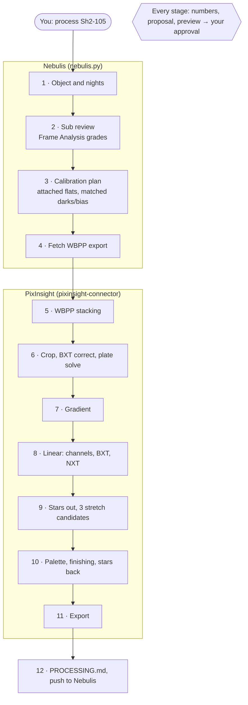

<p align="center">
  <picture>
    <source media="(prefers-color-scheme: dark)" srcset="brand/astroagent-horizontal-reversed.svg">
    
  </picture>
</p>

<p align="center"><a href="https://jjmartres.github.io/astroagent/">Website</a> · <a href="https://jjmartres.github.io/astroagent/fr/">Français</a> · <a href="https://jjmartres.github.io/astroagent/es/">Español</a> · <a href="https://jjmartres.github.io/astroagent/it/">Italiano</a></p>

# astroagent

Agent skills to process astrophotography campaigns shot with my setup (Askar 91F, ZWO ASI585MC Air, Askar D1/D2 dual-band filters) from the **Nebulis** library to a finished image in **PixInsight**, with an AI agent (Claude Code or OpenCode) that proposes every stage and waits for your approval.

Nothing here modifies PixInsight or the connector: PixInsight is operated through [pixinsight-connector](https://github.com/mxcoppell/pixinsight-connector), used as published on npm. This repository holds only knowledge (skills), a Nebulis client script and a PJSR helper.

| Skill | What it does |
|---|---|
| `skills/astro-processing` | The workflow: sub review, calibration plan, WBPP stacking, D1/D2 channel extraction and HOO/SHO palettes (or the broadband path), starless stretch with three candidates, finishing, export, `PROCESSING.md`, push back to Nebulis. Rig facts, calibration rules and quality gates are in its `reference/` folder. |
| `skills/nebulis` | A command-line client (`scripts/nebulis.py`) for the Nebulis API: objects, nights, Frame Analysis and keep/reject review, stacking plan, WBPP-ready export download, upload of results. Usable on its own. |

## How a session runs



## Requirements

- macOS (tested target), PixInsight 1.9.5 or later, with BlurXTerminator, NoiseXTerminator and StarXTerminator; GHS optional.
- Node.js 22 or later (for the connector), Python 3.9 or later (for `nebulis.py`, standard library only).
- A Nebulis server and an API key (Settings → API keys). An **admin** key is needed to record keep/reject decisions and to upload results.
- Claude Code or OpenCode.

## Install

### 1. The PixInsight connector

```sh
npm install -g pixinsight-connector@2.5.2
pixinsight-connector doctor
```

Register it as the MCP server `pixinsight`:

- Claude Code: `claude mcp add -s user pixinsight -- pixinsight-connector`
- OpenCode (`~/.config/opencode/opencode.json`):

  ```json
  { "mcp": { "pixinsight": { "type": "local", "command": ["pixinsight-connector"] } } }
  ```

Recommended: the connector's companion skills (`pixinsight-preflight`, `pixinsight-target-intake`, `pixinsight-connector-troubleshooting`), which these skills call when they are present:

```sh
npx skills add mxcoppell/pixinsight-connector-skills
```

### 2. These skills

Claude Code, as a plugin:

```sh
claude plugin marketplace add jjmartres/astroagent
claude plugin install astroagent@astroagent
```

The plugin does not register the `pixinsight` MCP server: use the one from step 1 (or from the
pixinsight-connector-skills plugin), never two, since two connectors compete for PixInsight's script slot.

OpenCode, or Claude Code without the plugin system:

```sh
git clone https://github.com/jjmartres/astroagent ~/Repositories/astroagent
~/Repositories/astroagent/install.sh
```

`install.sh` links both skills into `~/.claude/skills/`, which Claude Code and OpenCode both read. `git pull` updates them.

Any Agent Skills harness: `npx skills add jjmartres/astroagent`.

### 3. Nebulis credentials

`nebulis.py` reads two settings, from the environment first, then from `~/.config/astroagent/env`:

| Variable | Value |
|---|---|
| `ASTROAGENT_NEBULIS_URL` | Your Nebulis server, as you open it in a browser (for example `http://nas.local:3001`) |
| `ASTROAGENT_NEBULIS_API_KEY` | A key from Nebulis, Settings → API keys (`neb-…`); an admin key to record reviews and upload results |

Environment variables, in zsh (`~/.zshrc`) or bash (`~/.bashrc`):

```sh
export ASTROAGENT_NEBULIS_URL=http://nas.local:3001
export ASTROAGENT_NEBULIS_API_KEY=neb-...
```

In fish (`~/.config/fish/config.fish`):

```fish
set -gx ASTROAGENT_NEBULIS_URL http://nas.local:3001
set -gx ASTROAGENT_NEBULIS_API_KEY neb-...
```

Open a new terminal, or `source` the file, before starting Claude Code or OpenCode, so the agent inherits the variables.

Or the file, which keeps the key out of your shell configuration (works in fish, bash and zsh):

```sh
mkdir -p ~/.config/astroagent
printf '%s\n' 'ASTROAGENT_NEBULIS_URL=http://nas.local:3001' 'ASTROAGENT_NEBULIS_API_KEY=neb-...' > ~/.config/astroagent/env
chmod 600 ~/.config/astroagent/env
```

Check with `python3 ~/.claude/skills/nebulis/scripts/nebulis.py status` (with the plugin, the script is in the plugin's folder under `~/.claude/plugins/`).

### 4. WBPP, once

Open WeightedBatchPreprocessing in PixInsight and check that colour (CFA) images are debayered for your ASI585MC data; save. The connector runs WBPP headless with the parameters the skill passes, and WBPP's saved settings for the rest.

### 5. Where files go

Each object is processed in `$ASTROAGENT_ROOT/<OBJECT>/` (default `~/Astro/Processing/<OBJECT>/`):

```
data/<OBJECT>_<nights>_wbpp/   the Nebulis export (read-only for the agent)
agentic/                       connector scratch, previews, session file, call log
output/wbpp/                   WBPP output and masters
output/final/                  XISF, TIFF, JPEG
output/PROCESSING.md           the processing log
```

## Use

Open Claude Code or OpenCode in a terminal and ask in plain words. The agent loads the skill, then walks you through the stages, calling Nebulis and PixInsight as it goes. An example Claude Code session, shortened, with illustrative numbers:

```text
> Process Sh2-105 with astro-processing.

⏺ Skill(astro-processing)
  ⎿  Successfully loaded skill
✻ Thinking…
  The user wants a full processing run. Stage 0: check Nebulis, then list the nights and pick
  the path from the filters.
⏺ Bash(python3 ~/.claude/skills/nebulis/scripts/nebulis.py sessions Sh2-105)
  ⎿  2026-09-05  filters D1   exposures 180   subs 120
     2026-09-06  filters D1   exposures 180   subs 120
     … +7 lines (ctrl+o to expand)
⏺ Nebulis 2.2.0 connected. Sh2-105 has 9 nights: 7 with D1, 2 with D2, 180 s, gain 200. That is
  the narrowband path. Process all 9 nights?

> yes

⏺ Bash(python3 ~/.claude/skills/nebulis/scripts/nebulis.py analysis Sh2-105 2026-09-08
  --bad-only)
  ⎿  Sh2-105 2026-09-08 · measured 120/120 · kept 120/120
     grades: fair 4, good 116 · flags: soft 4
     typical frame: stars 812 · FWHM 2.6 px · elongation 1.08
     … +4 lines (ctrl+o to expand)
⏺ Sub review: 962 of 1,000 subs kept; the night of 09-12 lost 31 subs to clouds. On 09-08, 4
  subs are graded fair: soft stars, FWHM 3.4 px against 2.6. Keep or reject them?

> reject the 4 soft ones

⏺ Bash(python3 ~/.claude/skills/nebulis/scripts/nebulis.py review --reject
  Sh2-105/2026-09-08/Light_Sh2-105_180.0s_D1_0041.fit …)
  ⎿  4 frame(s) set to reject
⏺ Bash(python3 ~/.claude/skills/nebulis/scripts/nebulis.py plan Sh2-105 --all)
  ⎿  Sh2-105 · nights 2026-09-05 … 2026-09-27
     lights 958 kept, 42 not kept · errors 0 · warnings 1
       ! warning: flat_other_night {"bundle": "Flat_D2_0.42s", "days": 3}
     … +38 lines (ctrl+o to expand)
✻ Thinking…
  One warning: D2 flats 3 days from the D2 nights. Allowed by rule R1 only if the rotator angle
  did not change. Ask, do not assume.
⏺ Done in Nebulis. Calibration plan: 0 errors, 1 warning. The D2 flats are 3 days from the D2
  nights, same filter. Was the rotator angle unchanged during the campaign?

> unchanged, accept

⏺ Bash(python3 ~/.claude/skills/nebulis/scripts/nebulis.py fetch Sh2-105 --all --dest
  ~/Astro/Processing/Sh2-105/data --allow-warnings)
  ⎿  unpacked to ~/Astro/Processing/Sh2-105/data/Sh2-105_9-nights_wbpp
     lights 958 (plan 958) · layout wbpp
⏺ pixinsight - run_wbpp (MCP)(input_dirs: ["…/data/Sh2-105_9-nights_wbpp"], output_dir: "wbpp",
  keywords: [{name: "NIGHT", mode: "pre"}], rejection: "Auto", local_normalization: true)
  ⎿  WBPP started headless · run id 20261106-153204
⏺ pixinsight - wbpp_status (MCP)(run_id: "20261106-153204")
  ⎿  finished · exit code 0 · 41m 12s
     master/masterLight_FILTER-D1_EXPTIME-180.xisf
     master/masterLight_FILTER-D2_EXPTIME-180.xisf
⏺ WBPP finished: D1 master 38.4 h, D2 master 9.5 h, both 3-channel. Next, crop, BXT correction
  and plate solve: astrometry 0.08 px, pass. Then the gradient: proposal and preview below.

  · · · gradient · channels · deconvolution · noise reduction · one approval each · · ·

⏺ pixinsight - get_image_stats (MCP)(view_id: "HOO_s3")
  ⎿  median 0.251 · clampFractions at 1: R 0.0014, G 0.0009, B 0.0011
⏺ Three stretch candidates side by side. s3 clips 0.14 % of pixels to white, above the 0.1 %
  gate: rejected. s1 or s2?

> s2, and show me HOO against the Foraxx palette

⏺ pixinsight - export_image (MCP)(view_id: "Sh2_105_Foraxx", file_path:
  "final/Sh2-105_Foraxx_2026-11-06.xisf")
  ⎿  Wrote output/final/Sh2-105_Foraxx_2026-11-06.xisf (32-bit)
⏺ Foraxx kept. Exported final/Sh2-105_Foraxx_2026-11-06 as .xisf, .tif and .jpg, and wrote
  PROCESSING.md. Store them with Sh2-105 in Nebulis?

> yes

⏺ Bash(python3 ~/.claude/skills/nebulis/scripts/nebulis.py push Sh2-105 --bundle output/push
  --name Sh2-105_2026-11-06_processing.zip)
  ⎿  stored Sh2-105_2026-11-06_processing.zip (41.3 MB) with Sh2-105
⏺ Stored in Nebulis under Project archives. The final image is open in PixInsight; every other
  view of this session is closed.

╭────────────────────────────────────────────────────────────╮
│ >                                                          │
╰────────────────────────────────────────────────────────────╯
```

Good to know:

- **Pick up later.** Say *"continue Sh2-105"*: the agent reads its session file and resumes at the first stage not done.
- **Let a stage run alone.** Say *"run stacking without asking"*: that stage no longer waits, for this session only.
- **Nebulis on its own.** *"Which subs were bad last night on NGC 6888?"* or *"fetch Sh2-112 for stacking"* use only the `nebulis` skill.
- **Change a value.** Answer a proposal with another value (*"denoise 0.4"*); the agent keeps it for the rest of the session and logs it.

## Brand and website

The logo, its variants and icons are in `brand/` (usage in `brand/BRAND.md`). The website is generated from `site/` by `python3 site/build.py` into `_site/` and published to GitHub Pages by `.github/workflows/pages.yml`.

## Tests

```sh
python3 -m unittest discover -s tests
```

The tests run `nebulis.py` against a local mock of the Nebulis API. The PixInsight side cannot run in CI; `skills/astro-processing/scripts/pjsr/astro-helpers.js` is checked by hand on real data.

## Status

Version 0.1.0, not yet run end to end on real data. See `CHANGELOG.md`. Every processing value in the skills is a starting point; tune it on your data and commit the values that work.

## Credits

- [pixinsight-connector](https://github.com/mxcoppell/pixinsight-connector) and [pixinsight-connector-skills](https://github.com/mxcoppell/pixinsight-connector-skills) by Min Xie (MIT): the PixInsight tools; `scanBorders` and the astrometry gate thresholds are adapted from the companion skills.
- [Nebulis](https://github.com/nebulis-app/nebulis): the library, Frame Analysis and stacking export the workflow relies on.
- Foraxx palette idea by Paulo Tavares.

MIT License, see `LICENSE`.
